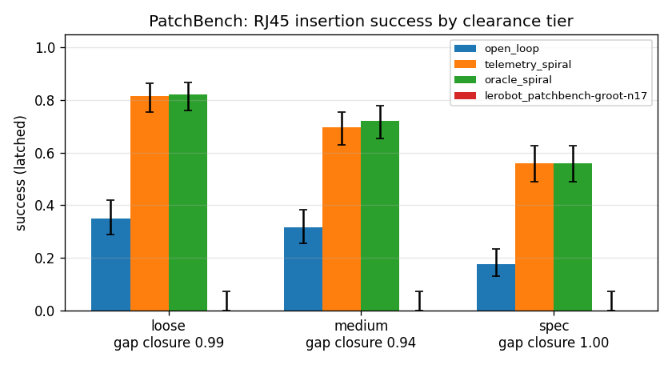
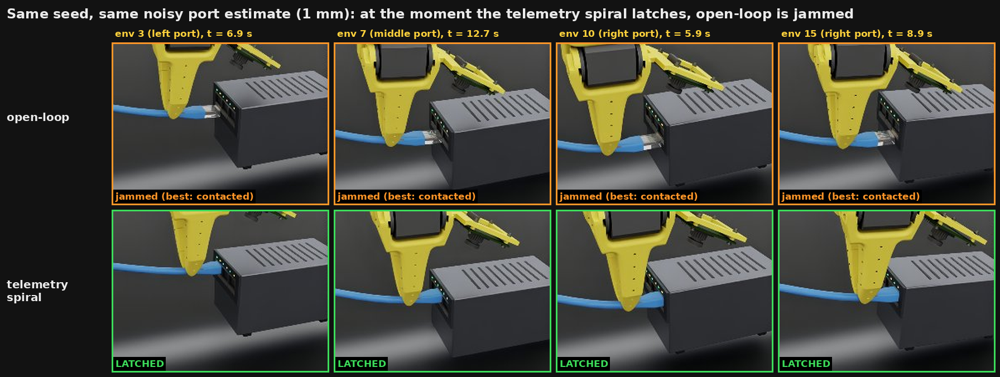
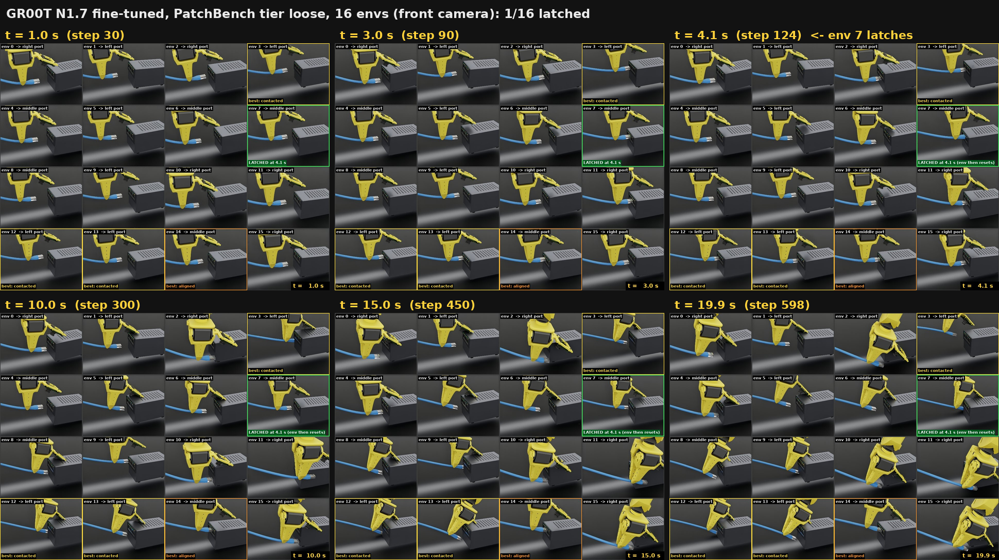
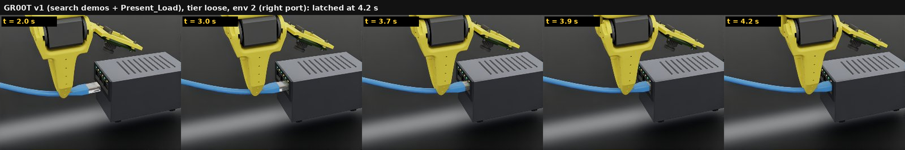

# PatchBench

An [Isaac Lab-Arena](https://github.com/isaac-sim/IsaacLab-Arena) benchmark for contact-rich insertion with a
$120 arm: an SO-101 inserts an RJ45 plug into a 3-port panel at three clearance tiers. Success is staged
(reach → contact → align → seat → latch) and reported as a funnel per tier.

The SO-101 has no force sensor. Its STS3215 servos do report their PWM duty (`Present_Load`) and current
(`Present_Current`); [so101-contact](https://github.com/UD-Y/so101-contact) simulates those registers exactly as
LeRobot reads them on a real arm. PatchBench asks how much of a force sensor's benefit that telemetry recovers.

## Result

Three scripted controllers that differ only in what they sense, n = 200 episodes per cell, port-pose estimate
noise σ = 1 mm, PhysX:

| | loose (+0.50 mm) | medium (+0.25 mm) | spec (+0.115 mm) |
|---|---|---|---|
| **open-loop**: push along the estimated port axis | 0.35 [0.29, 0.42] | 0.32 [0.25, 0.38] | 0.17 [0.13, 0.23] |
| **telemetry spiral**: spiral search, contact and drop-in from simulated `Present_Load` | 0.81 [0.76, 0.86] | 0.69 [0.63, 0.75] | 0.56 [0.49, 0.63] |
| **oracle spiral**: same search, true plug–jack force | 0.82 [0.76, 0.87] | 0.72 [0.65, 0.78] | 0.56 [0.49, 0.63] |
| **gap closure** (telemetry − open-loop) / (oracle − open-loop) | **0.99** [0.84, 1.17] | **0.94** [0.74, 1.18] | **1.00** [0.77, 1.29] |

Latch rate with Wilson 95 % intervals; gap-closure intervals from Jeffreys posteriors. Full funnels, time to latch
and provenance: [results/LEADERBOARD.md](results/LEADERBOARD.md).



What the difference looks like (16 envs, same seeds and port-pose noise for both controllers; an illustration, the
table above is the measurement). At the moment the telemetry spiral latches, open-loop is jammed against the jack
face on the same seed:



Real-time video of all 16 envs side by side (open-loop 7/16, telemetry spiral 11/16 latched):
[open_loop_vs_telemetry_loose.mp4](results/hero_loose16/open_loop_vs_telemetry_loose.mp4). Recorded with
`evaluate.py --enable_cameras --save_frames_every 2`, rendered with `scripts/eval_frames_video.py`.

Within this search strategy, the servo's own load signal does about as well as a perfect force sensor. What that
does and does not show:

- The oracle uses the same spiral search, so gap closure measures **sensing**, not search: a better searcher could
  raise the oracle line.
- The servo model is a hardware-identified fit (Rhoban BAM) of one STS3215. The benchmark default
  `explicit` servo friction has no gearbox stiction, which makes the simulated telemetry cleaner than a real
  gearbox. The stiction mode (`--servo_friction_mode physx_joint`) latched 41/60 vs 45/60 for the expert on
  loose, within noise; the sweep above was not repeated in it.
- The plug is rigidly fixed in the gripper (no in-hand slip), and nothing here has run on a real arm yet: the
  [calibration protocol](https://github.com/UD-Y/so101-contact/blob/main/docs/CALIBRATION_PROTOCOL.md) is how
  the sim-to-real check would be done.

## GR00T N1.7 baseline (vision + joint positions)

`UD77/patchbench-groot-n17`: [GR00T N1.7-3B](https://huggingface.co/nvidia/GR00T-N1.7-3B) fine-tuned with
`lerobot-train` (6000 steps, 1× L40S) on [`UD77/patchbench-so101-v0`](https://huggingface.co/datasets/UD77/patchbench-so101-v0)
(600 latched expert episodes, loose + medium, front + wrist cameras at 480×640, 30 fps). Evaluated through the same
evaluator (`--policy lerobot`, policy served from the LeRobot venv over ZMQ), n = 50 per tier:

| | reached | contacted | aligned | latched |
|---|---|---|---|---|
| loose | 0.32 | 0.30 | 0.00 | **0.00** [0.00, 0.07] |
| medium | 0.42 | 0.42 | 0.00 | **0.00** [0.00, 0.07] |
| spec | 0.40 | 0.38 | 0.00 | **0.00** [0.00, 0.07] |

What it learned: the approach with the plug in hand and the port named in the instruction. It reaches (plug tip
within 10 mm and 10° of the port mouth) and touches the *target* port in about a third of episodes, at similar rates
for left, middle and right, and almost never the wrong one (wrong-port 0–4 %). In a separate 16-env camera run on
loose it latched once (env 7, middle port, 4.1 s; 1/16). Offline, on training frames, it predicts the expert's
joint goals within 0.2–0.7° (holding still: 1.6°), so the policy server and action decoding are correct
(`scripts/check_policy_offline.py`).



Video: [groot_loose_16env.mp4](results/lerobot_patchbench-groot-n17/groot_loose_16env.mp4) (real time; each cell
labelled with its target port and furthest stage). The latched episode:
[groot_loose_env7_latch.png](results/lerobot_patchbench-groot-n17/groot_loose_env7_latch.png).

Why it does not latch:

- **What the demonstrations contained.** v0 was generated with the expert's default controller, `open_loop`, given the
  *true* port pose (σ = 0). Every demo is a straight push that works only because the expert knew the port position
  exactly; there is no search and no reaction to contact, so there is nothing contact-driven to imitate.
- **What the policy can sense.** Its inputs are two camera images (resized to 256×256 inside N1.7, where the
  0.1–0.5 mm clearance is about a pixel) and joint positions. Closed-loop error compounds: 0.6° at the shoulder is
  about 3 mm at the plug tip. It gets no force or load signal.
- **Not the chunk length.** Re-planning every 4 steps instead of executing whole 16-step chunks did not change the
  outcome on loose (0/50 latched; reached 0.32, aligned 0.04;
  [ablation_replan4](results/lerobot_patchbench-groot-n17/ablation_replan4/loose.json)).

### GR00T v1: search demos + servo load in the state

`UD77/patchbench-groot-n17-load` changes both causes and nothing else (same model, recipe, 6000 steps, cameras,
evaluator): [`UD77/patchbench-so101-v1`](https://huggingface.co/datasets/UD77/patchbench-so101-v1) has 600 latched
episodes from the **telemetry-spiral** expert given a port estimate with 1.5 mm noise (so the demos contain approach
→ contact → spiral search → drop-in → latch), and `observation.state` = 6 joint positions + 6 signed `Present_Load`
registers (`scripts/to_lerobot.py --state_with_load`; GR00T N1.7 reads only `observation.state`, and its relative
actions use the first 6 dims). n = 50 per tier:

| | reached | contacted | aligned | seated | latched | v0 latched |
|---|---|---|---|---|---|---|
| loose | 0.46 | 0.40 | 0.14 | 0.10 | **0.08** [0.03, 0.19] | 0.00 |
| medium | 0.42 | 0.38 | 0.12 | 0.04 | **0.04** [0.01, 0.13] | 0.00 |
| spec | 0.50 | 0.44 | 0.06 | 0.00 | **0.00** [0.00, 0.07] | 0.00 |

v1 gets past every stage v0 never reached (aligned, seated, latched); pooled over tiers it latched 6/150 vs 0/150
(Fisher exact p = 0.03). It is still far below the scripted controller that reads the same register (0.81 / 0.69 /
0.56). Offline it fits the search demos less tightly than v0 fit straight pushes (0.99° chunk error vs 1.43° for
holding still), which is expected for a multimodal search. What this shows: a VLA can only imitate the sensing its
demonstrations used; with contact-driven demos and the load register in its state, GR00T starts to insert, and the
remaining gap to the scripted search on the same signal is what PatchBench measures.



Side-by-side video of both fine-tunes on 16 loose envs:
[groot_v0_vs_v1_loose.mp4](results/lerobot_patchbench-groot-n17-load/groot_v0_vs_v1_loose.mp4) (each latched 1/16 in
that run; at n = 16 the difference in the tables above is not visible, so the video shows behaviour, not the rate).

## What is in the box

| Path | What |
|---|---|
| `patchbench/assets/build_assets.py` | parametric RJ45 plug (body + sprung latch on a revolute joint) and 3-port panel, primitives only, one USD per tier |
| `patchbench/environment.py`, `task.py`, `metrics.py` | Arena environment `rj45_panel`: SO-101 on STS3215 servo actuators, panel, plug in hand, staged task, metrics |
| `patchbench/predicates.py` | pure-torch stage logic (reach → contact → align → seat → latch), wrong-port detection |
| `patchbench/physics.py` | PhysX settings chosen by contact tuning, each with its run id |
| `patchbench/controllers/`, `policies.py` | IK, open-loop and spiral (telemetry / oracle) controllers, Arena policies |
| `scripts/evaluate.py`, `leaderboard.py` | evaluator (results JSON per policy × tier) and leaderboard + gap closure |
| `patchbench/policy_server.py` | ZMQ protocol to evaluate LeRobot policies (e.g. GR00T N1.7) from a separate venv |
| `scripts/gen_data.py`, `to_lerobot.py` | expert rollouts with cameras → LeRobot v3 dataset (real SO-101 conventions) |
| `scripts/check_policy_offline.py`, `eval_frames_video.py` | offline check of a LeRobot checkpoint against recorded expert actions; annotated video/collage from `evaluate.py --save_frames_every` grids |
| `scripts/check_contact.py`, `hold_test.py` | contact tuning (virtual wrist) and the SO-101 servo hold / press test |
| `scripts/brev/` | setup and overnight chain for a 1× L40S VM |
| `docs/` | [BENCHMARK.md](docs/BENCHMARK.md) (protocol, formats, policy server), [ENV_AUDIT.md](docs/ENV_AUDIT.md) (versions, APIs, pitfalls), DATA.md |

## Install

Linux, an RTX GPU (cameras need RT cores: L40S yes, H100/A100 no), Python 3.12, [uv](https://docs.astral.sh/uv/).
Pinned: IsaacLab-Arena `aa36f19` (Isaac Lab submodule `bb0c8e1`, Isaac Sim 6.1.0.0), isaaclab-so101 `12a3ecc`.

```bash
mkdir -p ~/work && cd ~/work
GIT_LFS_SKIP_SMUDGE=1 git clone https://github.com/isaac-sim/IsaacLab-Arena.git && cd IsaacLab-Arena
GIT_LFS_SKIP_SMUDGE=1 git checkout aa36f19
git submodule init -- submodules/IsaacLab
git config submodule.submodules/IsaacLab.url https://github.com/isaac-sim/IsaacLab.git
GIT_LFS_SKIP_SMUDGE=1 git submodule update --depth 1 -- submodules/IsaacLab
uv sync && source .venv/bin/activate && export OMNI_KIT_ACCEPT_EULA=YES ACCEPT_EULA=Y
cd ~/work
git clone https://github.com/art-e-fact/isaaclab-so101 && git -C isaaclab-so101 checkout 12a3ecc
git clone https://github.com/UD-Y/so101-contact && git clone https://github.com/UD-Y/patchbench
uv pip install -e isaaclab-so101 -e so101-contact -e patchbench pyzmq   # repeat after every `uv sync`
```

## Run

```bash
cd ~/work/patchbench
python scripts/evaluate.py --policy telemetry_spiral --tiers loose,medium,spec --n 200 --num_envs 32
python scripts/leaderboard.py
```

On a shared machine, wrap every Isaac Sim launch in `flock -o ~/work/.isaac.lock …` (one Isaac process at a time;
`-o` matters, see ENV_AUDIT section 11). The full sweep (3 policies × 3 tiers × 200) took about 75 min on an
RTX 4060 laptop GPU, state-only. Evaluating your own LeRobot policy: `--policy lerobot --policy.path <hf repo>`
(see [BENCHMARK.md](docs/BENCHMARK.md) section 5).

Watch it: `--viz kit` opens the viewer on `scripts/hold_test.py` and `scripts/check_contact.py`, e.g.

```bash
python scripts/check_contact.py --viz kit --tiers medium --offsets_mm 0 --tilts_deg 0 --seeds 1 --pos_iters 32 --cutaway --hold_open
```

## Reproduce the GR00T runs and videos (1× L40S)

```bash
bash scripts/brev/setup_brev.sh                    # once per VM (venvs, pinned repos, HF token)
bash scripts/brev/chain_overnight.sh               # v0: open-loop expert data -> UD77/patchbench-so101-v0 -> GR00T
bash scripts/brev/run_v1.sh                        # v1: search demos + Present_Load -> GR00T, eval, 16-env video
python scripts/evaluate.py --policy lerobot --policy.path UD77/patchbench-groot-n17 --n_action_steps 4 \
  --name lerobot_patchbench-groot-n17_replan4 --tiers loose --n 50 --num_envs 16      # re-plan ablation
python scripts/evaluate.py --policy telemetry_spiral --tiers loose --n 16 --num_envs 16 \
  --enable_cameras --save_frames_every 2 --out ~/eval_hero                            # hero video (also open_loop)
python scripts/eval_frames_video.py pair ~/eval_hero/open_loop ~/eval_hero/telemetry_spiral \
  --out results/hero_loose16/open_loop_vs_telemetry_loose
```

Datasets and models are on the Hub (`UD77/patchbench-so101-v0`, `-v1`, `UD77/patchbench-groot-n17`, `-n17-load`); raw
episodes are not kept (regenerate with the same seeds). The Newton showcase replays
`results/newton_showcase/sim_loose_port1.npz` (committed).

## How the numbers were made

- **Contact physics (gate G1):** a compliant "virtual wrist" pushed the plug into each tier with offsets and tilts;
  a reduced grid of 8 PhysX configs chose dt 1/480 s, 32 position iterations, 0.5 mm contact offset: the latch gives a
  repeatable rise → peak → drop force on all tiers, no explosions or tunnelling
  ([results/contact_tuning/REPORT.md](results/contact_tuning/REPORT.md)). Contact force must include friction
  (`track_friction_forces=True`, 64 contact slots); normal-only force under-reads the latch load ~10×.
- **Second engine:** the same probe on Newton 1.5 (MuJoCo-Warp, Newton collision pipeline, `impratio` 1000)
  reproduces the PhysX tier statistics: latch rate 0.87 / 0.67 / 0.68 vs 0.92 / 0.73 / 0.67 (loose / medium / spec,
  60 insertions per tier). With default MuJoCo settings the plug creeps into the port instead of jamming
  ([results/newton_vs_physx/REPORT.md](results/newton_vs_physx/REPORT.md)).
- **Servo:** STS3215 firmware loop → PWM duty → DC motor → BAM m5 gearbox friction, LeRobot gains (P = 16); hold
  test: sag ≤ 1.8°, 30° step settles in 0.33 s ([results/hold_test](results/hold_test)).
- **Controllers:** the expert (σ = 0) latched 16/20 on loose (gate G2).

## Status

v0.1 (21 Oct 2026). Done: assets, environment, contact tuning, servo actuator, three controllers, n = 200 sweep,
evaluator, LeRobot v3 dataset (600 episodes) on the Hub, GR00T N1.7 fine-tune and evaluation on a 1× L40S, Newton
cross-check, GR00T v1 (search demos, `Present_Load` in the state). Pending: a real-arm calibration run.

## License

Apache-2.0.
