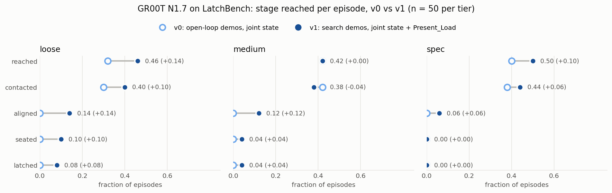

# LatchBench

LatchBench is an [Isaac Lab-Arena](https://github.com/isaac-sim/IsaacLab-Arena) benchmark for contact-rich insertion
with a $120 arm. An SO-101 pushes an RJ45 plug into a 3-port network switch at three clearance tiers. An episode
counts as a success only when the plug's latch clicks into place. Every episode is also scored by the furthest stage
it reached (reach, contact, align, seat, latch), so a failure tells you where it went wrong.

The SO-101 has no force sensor, but its STS3215 servos report the PWM duty they drive the motor with
(`Present_Load`) and their current (`Present_Current`). [servosense](https://github.com/UD-Y/servosense) simulates
those registers the same way LeRobot reads them on a real arm. The question LatchBench asks is how much of a real
force sensor's benefit you get from that telemetry alone.

## Result

Three scripted controllers that differ only in what they sense. 200 episodes per cell, port-pose estimate noise of
1 mm (standard deviation), PhysX:

| | loose (+0.50 mm) | medium (+0.25 mm) | spec (+0.115 mm) |
|---|---|---|---|
| **open-loop**: push along the estimated port axis | 0.35 [0.29, 0.42] | 0.32 [0.25, 0.38] | 0.17 [0.13, 0.23] |
| **telemetry spiral**: spiral search, contact and drop-in detected from simulated `Present_Load` | 0.81 [0.76, 0.86] | 0.69 [0.63, 0.75] | 0.56 [0.49, 0.63] |
| **oracle spiral**: the same search using the true plug-jack contact force | 0.82 [0.76, 0.87] | 0.72 [0.65, 0.78] | 0.56 [0.49, 0.63] |
| **gap closure**: (telemetry - open-loop) / (oracle - open-loop) | **0.99** [0.84, 1.17] | **0.94** [0.74, 1.18] | **1.00** [0.77, 1.29] |

Cells are latch rates with Wilson 95 % intervals. Gap-closure intervals come from Jeffreys posteriors. Full stage
funnels, time to latch and provenance are in [results/LEADERBOARD.md](results/LEADERBOARD.md).


Here is what the difference looks like on the same seeds and the same noisy port estimate. At the moment the
telemetry spiral latches, open-loop is stuck against the face of the jack:


There is also a real-time video of 16 environments side by side (open-loop latched 7 of 16, telemetry spiral 11 of
16): [open_loop_vs_telemetry_loose.mp4](results/hero_loose16/open_loop_vs_telemetry_loose.mp4). It is an illustration;
the table above is the measurement.

With this search strategy, the servo's own load signal does about as well as a perfect force sensor. Some limits on
that claim:

- The oracle uses the same spiral search, so gap closure measures sensing, not search. A better search could raise
  the oracle line.
- The servo model is a hardware-identified fit (Rhoban BAM) of one STS3215. The default `explicit` servo friction
  has no gearbox stiction, so the simulated telemetry is cleaner than a real gearbox would give. With stiction on
  (`--servo_friction_mode physx_joint`) the expert latched 41 of 60 on loose against 45 of 60 without it, which is
  within noise, but the full sweep was not repeated in that mode.
- The plug is rigidly attached to the gripper (no slip in the hand), and nothing here has run on a real arm yet. The
  [calibration protocol](https://github.com/UD-Y/servosense/blob/main/docs/CALIBRATION_PROTOCOL.md) describes how the
  sim-to-real check would be done.

## GR00T N1.7

We also fine-tuned NVIDIA's [GR00T N1.7-3B](https://huggingface.co/nvidia/GR00T-N1.7-3B) on demonstrations from this
environment to see how a vision-language-action model does on the same task. It is reported here on its own, not on
the leaderboard, because it is a different kind of policy: it sees two camera images and the joint state, and it
learns only from demonstrations. Both versions were trained with `lerobot-train` for 6000 steps on one L40S and run
through the same evaluator as the scripted controllers (`--policy lerobot`, 50 episodes per tier).

### The limitation we ran into (v0)

The first model, [`UD77/latchbench-groot-n17`](https://huggingface.co/UD77/latchbench-groot-n17), was trained on
[`UD77/latchbench-so101-v0`](https://huggingface.co/datasets/UD77/latchbench-so101-v0): 600 successful episodes
(loose and medium tiers, front and wrist cameras at 480x640, 30 fps). It never latched a plug: 0 of 50 on every tier.

It did learn the coarse part of the task. It carries the plug to the panel and picks the port named in the
instruction, reaching each of the left, middle and right ports at similar rates and almost never the wrong one. It
gets within 10 mm of the target port in about a third of episodes, but it never lines the plug up with the opening.
The pipeline itself was checked: on training frames the model predicts the expert's joint targets to within 0.2 to
0.7 degrees ([check_policy_offline.py](scripts/check_policy_offline.py)), and executing 4 actions per prediction
instead of 16 did not change the result (0 of 50 on loose,
[ablation](results/lerobot_latchbench-groot-n17/ablation_replan4/loose.json)).

The cause was the data. The v0 demonstrations came from the open-loop expert, which was given the exact port
position. Every demo is a straight push that only works because the expert knew where the port was. There is no
search and no reaction to touching the panel, so the model had nothing contact-driven to copy. On top of that, its
inputs are camera images (resized to 256x256 inside the model, where the 0.1 to 0.5 mm clearance is about one pixel)
and joint angles, with no force or load signal at all.

### What we changed (v1)

[`UD77/latchbench-groot-n17-load`](https://huggingface.co/UD77/latchbench-groot-n17-load) fixes both of those and
nothing else: same model, recipe, training steps, cameras and evaluator.

- New demonstrations, [`UD77/latchbench-so101-v1`](https://huggingface.co/datasets/UD77/latchbench-so101-v1): 600
  successful episodes from the telemetry-spiral expert, given a port estimate with 1.5 mm of noise. The expert has
  to touch the panel, search and drop in, so the demos contain that behaviour.
- A load signal in the input: `observation.state` holds the 6 joint positions followed by the 6 signed
  `Present_Load` registers (`scripts/to_lerobot.py --state_with_load`). GR00T N1.7 reads only `observation.state`,
  and its relative actions use the first 6 values, so the joint positions stay in front.

### v0 vs v1



| tier | model | reached | contacted | aligned | seated | latched |
|---|---|---|---|---|---|---|
| loose | v0 | 0.32 | 0.30 | 0.00 | 0.00 | 0/50 |
| loose | v1 | 0.46 | 0.40 | 0.14 | 0.10 | **4/50** (0.08 [0.03, 0.19]) |
| medium | v0 | 0.42 | 0.42 | 0.00 | 0.00 | 0/50 |
| medium | v1 | 0.42 | 0.38 | 0.12 | 0.04 | **2/50** (0.04 [0.01, 0.13]) |
| spec | v0 | 0.40 | 0.38 | 0.00 | 0.00 | 0/50 |
| spec | v1 | 0.50 | 0.44 | 0.06 | 0.00 | 0/50 |

Generated with [`scripts/groot_report.py`](scripts/groot_report.py); the same table with intervals is in
[results/GROOT.md](results/GROOT.md).

v1 gets through the stages v0 never reached: it aligns, seats and latches. Over all three tiers it latched 6 of 150
episodes against 0 of 150 for v0 (two-sided Fisher exact test, p = 0.03). That is a real improvement but a small one.
The scripted controller reading the same load register still latches 81, 69 and 56 % of the time. A policy trained
from demonstrations can only pick up the sensing its demonstrations used, and the distance that remains between v1
and the scripted search is the gap this benchmark is meant to measure.

One of the v1 latches (right port, 4.2 s):


Videos of 16 loose episodes: [v0 alone](results/lerobot_latchbench-groot-n17/groot_loose_16env.mp4) and
[v0 and v1 side by side](results/lerobot_latchbench-groot-n17-load/groot_v0_vs_v1_loose.mp4). Each model latched once
in that 16-episode run, so the videos show behaviour rather than the success rate.

Things that would likely help next: longer training (v1 saw each frame only about 1.4 times), giving the model the
change in load rather than its raw value (the scripted controller compares against a baseline taken before contact),
and more demonstrations.

## Repository layout

| Path | What |
|---|---|
| `latchbench/assets/build_assets.py` | parametric RJ45 plug (body plus a sprung latch on a revolute joint) and 3-port panel, built from primitives, one USD per tier |
| `latchbench/environment.py`, `task.py`, `metrics.py` | Arena environment `rj45_panel`: SO-101 on STS3215 servo actuators, panel, plug in hand, staged task, metrics |
| `latchbench/predicates.py` | stage logic in plain torch (reach, contact, align, seat, latch) and wrong-port detection |
| `latchbench/physics.py` | PhysX settings chosen by contact tuning, each with its run id |
| `latchbench/controllers/`, `policies.py` | IK, open-loop and spiral (telemetry or oracle) controllers, Arena policies |
| `scripts/evaluate.py`, `leaderboard.py` | evaluator (results JSON per policy and tier) and the scripted-controller leaderboard |
| `scripts/groot_report.py` | GR00T v0 vs v1 table and chart |
| `latchbench/policy_server.py` | ZMQ protocol for evaluating LeRobot policies (such as GR00T N1.7) from a separate venv |
| `scripts/gen_data.py`, `to_lerobot.py` | expert rollouts with cameras, converted to a LeRobot v3 dataset (real SO-101 conventions) |
| `scripts/check_policy_offline.py`, `eval_frames_video.py` | offline check of a LeRobot checkpoint against recorded expert actions; annotated videos from `evaluate.py --save_frames_every` |
| `scripts/check_contact.py`, `hold_test.py` | contact tuning (virtual wrist) and the SO-101 servo hold and press test |
| `scripts/brev/` | setup and run scripts for a single L40S VM |
| `docs/` | [BENCHMARK.md](docs/BENCHMARK.md) (protocol, formats, policy server), [ENV_AUDIT.md](docs/ENV_AUDIT.md) (versions, APIs, pitfalls), DATA.md |

## Install

Linux, an RTX GPU (cameras need RT cores: an L40S works, an H100 or A100 does not), Python 3.12 and
[uv](https://docs.astral.sh/uv/). Pinned versions: IsaacLab-Arena `aa36f19` (Isaac Lab submodule `bb0c8e1`, Isaac Sim
6.1.0.0) and isaaclab-so101 `12a3ecc`.

```bash
mkdir -p ~/work && cd ~/work
GIT_LFS_SKIP_SMUDGE=1 git clone https://github.com/isaac-sim/IsaacLab-Arena.git && cd IsaacLab-Arena
GIT_LFS_SKIP_SMUDGE=1 git checkout aa36f19
git submodule init -- submodules/IsaacLab
git config submodule.submodules/IsaacLab.url https://github.com/isaac-sim/IsaacLab.git
GIT_LFS_SKIP_SMUDGE=1 git submodule update --depth 1 -- submodules/IsaacLab
uv sync && source .venv/bin/activate && export OMNI_KIT_ACCEPT_EULA=YES ACCEPT_EULA=Y
cd ~/work
git clone https://github.com/art-e-fact/isaaclab-so101 && git -C isaaclab-so101 checkout 12a3ecc
git clone https://github.com/UD-Y/servosense && git clone https://github.com/UD-Y/latchbench
uv pip install -e isaaclab-so101 -e servosense -e latchbench pyzmq   # repeat after every `uv sync`
```

## Run

```bash
cd ~/work/latchbench
python scripts/evaluate.py --policy telemetry_spiral --tiers loose,medium,spec --n 200 --num_envs 32
python scripts/leaderboard.py
```

On a shared machine, wrap every Isaac Sim launch in `flock -o ~/work/.isaac.lock ...` so only one Isaac process runs
at a time (the `-o` matters, see ENV_AUDIT section 11). The full sweep (3 policies, 3 tiers, 200 episodes each) took
about 75 minutes on an RTX 4060 laptop GPU without cameras. To evaluate your own LeRobot policy, use
`--policy lerobot --policy.path <hf repo>` (see [BENCHMARK.md](docs/BENCHMARK.md) section 5).

To watch it, `--viz kit` opens the viewer for `scripts/hold_test.py` and `scripts/check_contact.py`, for example:

```bash
python scripts/check_contact.py --viz kit --tiers medium --offsets_mm 0 --tilts_deg 0 --seeds 1 --pos_iters 32 --cutaway --hold_open
```

## Reproducing the GR00T runs and videos (one L40S)

```bash
bash scripts/brev/setup_brev.sh                    # once per VM (venvs, pinned repos, HF token)
bash scripts/brev/chain_overnight.sh               # v0: open-loop expert data, dataset, GR00T fine-tune
bash scripts/brev/run_v1.sh                        # v1: search demos with Present_Load, fine-tune, eval, video
python scripts/evaluate.py --policy lerobot --policy.path UD77/latchbench-groot-n17 --n_action_steps 4 \
  --name lerobot_latchbench-groot-n17_replan4 --tiers loose --n 50 --num_envs 16      # re-planning ablation
python scripts/evaluate.py --policy telemetry_spiral --tiers loose --n 16 --num_envs 16 \
  --enable_cameras --save_frames_every 2 --out ~/eval_hero                            # video frames (also open_loop)
python scripts/eval_frames_video.py pair ~/eval_hero/open_loop ~/eval_hero/telemetry_spiral \
  --out results/hero_loose16/open_loop_vs_telemetry_loose
python scripts/groot_report.py
```

The datasets and models are on the Hugging Face Hub (`UD77/latchbench-so101-v0`, `UD77/latchbench-so101-v1`,
`UD77/latchbench-groot-n17`, `UD77/latchbench-groot-n17-load`). Raw episodes are not kept; regenerate them with the
same seeds. The Newton showcase clip replays `results/newton_showcase/sim_loose_port1.npz`, which is committed.

## How the numbers were made

### Contact physics

A compliant "virtual wrist" pushed the plug into each tier with a range of offsets and tilts.
A reduced grid of 8 PhysX configurations picked dt = 1/480 s, 32 position iterations and a 0.5 mm contact offset.
With these the latch gives the same rise, peak and drop in force on every tier, with no explosions or tunnelling
([results/contact_tuning/REPORT.md](results/contact_tuning/REPORT.md)). The contact force has to include friction
(`track_friction_forces=True`, 64 contact slots); the normal force alone under-reads the latch load about 10 times.

### Second engine

The same probe on Newton 1.5 (MuJoCo-Warp with the Newton collision pipeline, `impratio` 1000)
gives latch rates of 0.87, 0.67 and 0.68 (loose, medium, spec) against 0.92, 0.73 and 0.67 on PhysX, 60 insertions
per tier. With default MuJoCo settings the plug creeps into the port instead of jamming
([results/newton_vs_physx/REPORT.md](results/newton_vs_physx/REPORT.md)).

### Servo

The servo model chains the STS3215 firmware position loop, PWM duty, a DC motor and BAM m5 gearbox friction,
using LeRobot's gains (P = 16). In the hold test the arm sags at most 1.8 degrees and a 30 degree step settles in 0.33 s
([results/hold_test](results/hold_test)).

### Controllers

With the exact port pose, the expert latched 16 of 20 on loose.

## Status

v0.1 (21 Oct 2026). Done: assets, environment, contact tuning, servo actuator, three scripted controllers, the
200-episode sweep, evaluator, two LeRobot v3 datasets on the Hub, GR00T N1.7 v0 and v1 fine-tunes and evaluations on
one L40S, and the Newton cross-check. Not done yet: a calibration run on a real arm.

## License

Apache-2.0.
